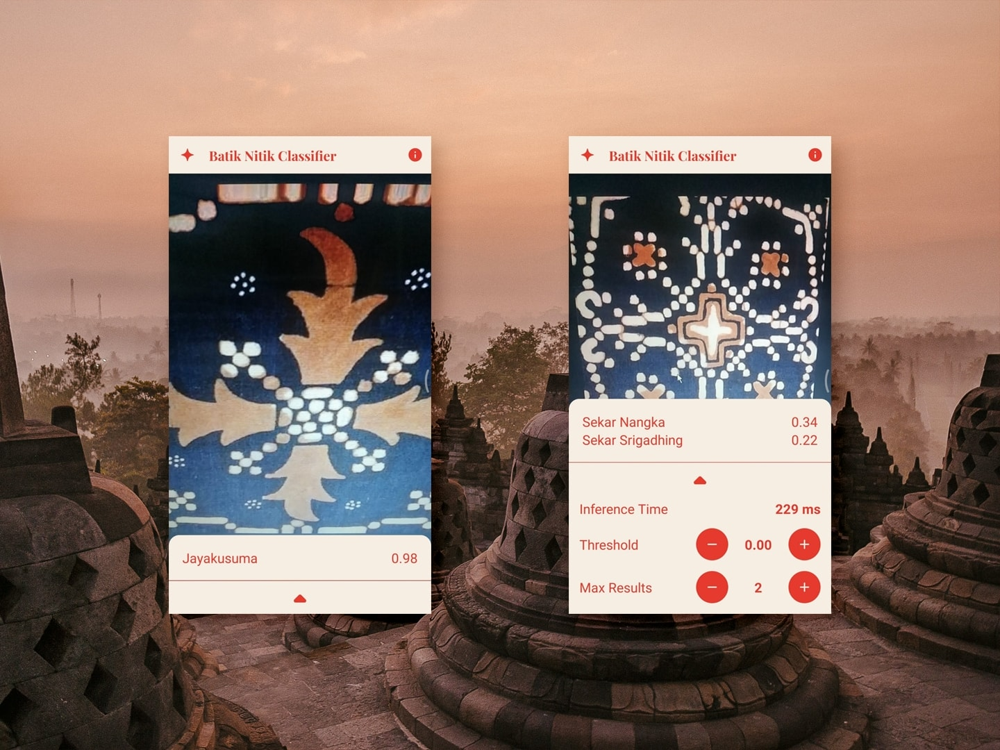

<div align="center">
  
  <h1>Batik Nitik Classifier</h1>
  <p>
    <a href="https://www.android.com/versions/nougat-7-0/"></a>
    <a href="https://github.com/JetBrains/kotlin/releases/tag/v1.9.0"></a>
    <a href="https://www.tensorflow.org/lite/inference_with_metadata/task_library/image_classifier"></a>
    <a href="https://docs.gradle.org/8.7/release-notes.html"></a>
    <a href="https://www.oracle.com/java/technologies/javase/jdk17-archive-downloads.html"></a>
    <a href="https://developer.android.com/build/releases/past-releases/agp-8-5-0-release-notes"></a>
  </p>
</div>

An Android app that identifies **Batik Nitik** motifs from live camera feeds using a local TensorFlow Lite classification model, displaying real-time top predictions and confidence scores across 60 classes.



## Features

- Live classification of 60 batik nitik motifs through the back camera.
- On-device inference; no network access or image upload.
- Adjustable score threshold (0.10–0.90) and maximum results (1–3).
- Tap-to-focus on the camera preview.
- Displayed inference time for each analyzed frame.
- Camera permission requested before the camera opens, with a toast when it is denied.

## Requirements

- Android 7.0+ (API 24+) or newer device with a back camera.
- JDK 17 to build (required by Android Gradle Plugin 8.5).
- Android Studio Ladybug or newer, or a command-line Android SDK with `compileSdk 34` installed.

## Getting Started

```bash
git clone https://github.com/ricky-kiva/ugm-andro-nitik-classifier.git
cd ugm-andro-nitik-classifier
./gradlew assembleDebug
```

On Windows, use `gradlew.bat assembleDebug`. The debug APK is written to `app/build/outputs/apk/debug/app-debug.apk`.

Open the project in Android Studio and run the `app` configuration to install it on a connected device. Unit tests: `./gradlew test`. Instrumented tests: `./gradlew connectedAndroidTest` (requires a device or emulator).

## How It Works

`CameraFragment` binds a CameraX `Preview` and an `ImageAnalysis` use case (4:3, `STRATEGY_KEEP_ONLY_LATEST`, RGBA_8888 output) to the back camera. Each analyzed frame is copied into a reused `Bitmap` and passed to `ImageClassifierHelper`, which wraps the frame in a `TensorImage`, sets the image orientation from the display rotation, and runs a TensorFlow Lite `ImageClassifier`. Results are sorted by score and rendered by `ClassificationResultsAdapter`; changing threshold or max results recreates the classifier with the new options.

The model assets live in `app/src/main/assets/`:

| File | Purpose |
|------|---------|
| `ugm-nitik-60.tflite` | Classifier; 224×224 RGB input, 60-class probability output |
| `ugm-nitik-60.json` | TensorFlow Lite metadata, including the label file association |
| `nitik-label.txt` | The 60 motif labels, one per line |

`noCompress 'tflite'` is set in `app/build.gradle` so the model is memory-mapped directly from the APK instead of being unpacked at startup.

## Project Structure

```
app/src/main/
├── assets/                         # TFLite model, metadata, labels
├── java/com/rickyslash/batiknitikclassifier/
│   ├── helper/ImageClassifierHelper.kt   # TFLite classifier setup and inference
│   ├── presentation/main/                # MainActivity and fragments
│   └── ui/ClassificationResultsAdapter.kt
└── res/                            # layouts, navigation, themes, launcher icons
```

## Model

The classifier weights are from the [Nitik Classifier Model by Ricky Fadel M](https://github.com/ricky-kiva/ugm-nitik-classifier/).

## Dataset

The model was trained on the [Batik Nitik 960](https://data.mendeley.com/datasets/sgh484jxzy) dataset.


© 2026 Ricky Fadel M. All rights reserved.
